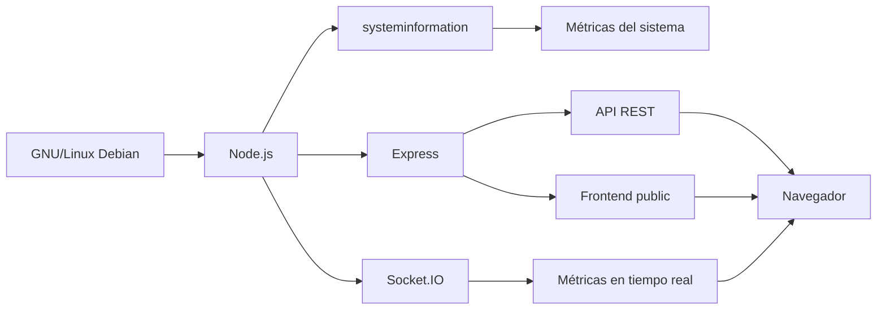

# LinuxGuard NOC

Sistema de monitoreo de recursos para servidores GNU/Linux desarrollado como **Trabajo Práctico Integrador Final de Práctica Profesionalizante III**.

LinuxGuard NOC permite visualizar en tiempo real información del sistema, consumo de recursos, procesos, servicios, alertas e historial de eventos desde un dashboard web responsive.

---

## Objetivo

El proyecto implementa una arquitectura cliente-servidor para monitorear un servidor GNU/Linux.

El backend obtiene información directamente del sistema operativo mediante Node.js y la biblioteca `systeminformation`.

La información se entrega al frontend mediante:

- API REST.
- Socket.IO para actualización en tiempo real.

El frontend se encuentra integrado dentro del propio backend mediante la carpeta `public`, por lo que toda la aplicación puede ejecutarse desde un único servidor.

---

## Arquitectura



La arquitectura utilizada es:

```text
Servidor Debian
│
├── systeminformation
│   └── obtiene métricas de GNU/Linux
│
├── Node.js + Express
│   ├── sirve el frontend
│   └── expone la API REST
│
├── Socket.IO
│   └── envía métricas en tiempo real
│
└── public/
    └── Dashboard HTML + CSS + JavaScript + Bootstrap 5
```

---

## Tecnologías utilizadas

### Backend

- Node.js
- Express
- Socket.IO
- systeminformation
- CORS
- JavaScript ES Modules
- pnpm

### Frontend

- HTML5
- CSS3
- JavaScript
- Bootstrap 5
- Canvas para gráficos
- Socket.IO Client

### Sistema y despliegue

- GNU/Linux Debian
- systemd
- Git
- GitHub

---

## Funcionalidades

LinuxGuard NOC permite monitorear:

- Uso de CPU.
- Modelo y cantidad de núcleos del procesador.
- Temperatura de CPU.
- Uso de memoria RAM.
- Uso de discos.
- Interfaces de red.
- Tráfico de red.
- Tiempo de actividad del sistema.
- Información del sistema operativo.
- Hostname.
- Kernel.
- Arquitectura.
- Procesos con mayor consumo.
- Estado de servicios del sistema.
- Alertas por utilización de recursos.
- Historial persistente de eventos.
- Configuración de umbrales de advertencia y estado crítico.

El dashboard se actualiza automáticamente mediante Socket.IO.

---

## Estados de monitoreo

Los recursos pueden encontrarse en tres estados:

- Normal.
- Advertencia.
- Crítico.

Los valores de los umbrales pueden configurarse desde el propio dashboard.

La configuración se almacena en:

```text
backend/config/thresholds.json
```

Los eventos generados se almacenan en:

```text
backend/data/events.json
```

---

## Estructura del proyecto

```text
linuxguard-noc/
│
├── backend/
│   │
│   ├── config/
│   │   └── thresholds.json
│   │
│   ├── data/
│   │   └── events.json
│   │
│   ├── public/
│   │   ├── css/
│   │   │   └── style.css
│   │   ├── js/
│   │   │   └── app.js
│   │   └── index.html
│   │
│   ├── services/
│   │   ├── alertService.js
│   │   ├── configService.js
│   │   ├── eventService.js
│   │   ├── serviceMonitor.js
│   │   └── systemService.js
│   │
│   ├── package.json
│   ├── pnpm-lock.yaml
│   └── server.js
│
└── README.md
```

---

## Componentes del backend

### `server.js`

Es el punto de entrada de la aplicación.

Se encarga de:

- iniciar Express;
- crear el servidor HTTP;
- configurar CORS;
- servir el directorio `public`;
- definir los endpoints REST;
- inicializar Socket.IO;
- enviar métricas periódicamente;
- escuchar conexiones en el puerto `3000`.

El servidor escucha sobre:

```text
0.0.0.0:3000
```

Esto permite acceder a LinuxGuard desde otros equipos de la misma red.

---

### `systemService.js`

Obtiene las métricas del sistema mediante `systeminformation`.

Entre otras cosas obtiene:

- CPU;
- memoria;
- temperatura;
- discos;
- interfaces de red;
- tráfico;
- sistema operativo;
- hostname;
- kernel;
- uptime;
- procesos.

---

### `serviceMonitor.js`

Consulta servicios GNU/Linux utilizando `systemctl`.

Actualmente se monitorean servicios como:

- SSH;
- nginx;
- Apache.

---

### `alertService.js`

Analiza las métricas y las compara con los umbrales configurados.

Determina los estados:

```text
normal
advertencia
critico
```

También genera las alertas correspondientes.

---

### `configService.js`

Gestiona los umbrales configurables almacenados en:

```text
config/thresholds.json
```

Realiza además validación de los valores enviados por el frontend.

---

### `eventService.js`

Guarda eventos y alertas en:

```text
data/events.json
```

El historial mantiene un máximo definido de eventos y evita almacenar repetidamente un mismo evento de manera consecutiva.

---

## Frontend

El frontend se encuentra en:

```text
backend/public/
```

Express lo publica mediante:

```js
app.use(express.static("public"));
```

Por lo tanto, al acceder a:

```text
http://IP_DEL_SERVIDOR:3000/
```

Express entrega automáticamente:

```text
public/index.html
```

El frontend utiliza:

- Bootstrap 5.
- CSS personalizado.
- JavaScript.
- Socket.IO.
- Canvas para los gráficos.

La interfaz tiene una estética inspirada en herramientas de monitoreo como Grafana.

---

## API REST

### Estado del backend

```http
GET /api/health
```

Permite comprobar que el backend está funcionando.

---

### Información del sistema

```http
GET /api/sistema
```

Devuelve métricas e información del servidor.

Incluye:

- CPU;
- memoria;
- discos;
- red;
- procesos;
- servicios;
- alertas;
- información del sistema.

---

### Historial de eventos

```http
GET /api/eventos
```

Devuelve el historial persistente de alertas y eventos.

---

### Consultar umbrales

```http
GET /api/config/umbrales
```

Devuelve los valores actuales de configuración.

---

### Modificar umbrales

```http
PUT /api/config/umbrales
```

Permite modificar los valores de advertencia y estado crítico.

---

## Socket.IO

Socket.IO se utiliza para enviar información en tiempo real entre el backend y el frontend.

Cuando un cliente se conecta, el servidor obtiene nuevas métricas aproximadamente cada dos segundos y emite:

```text
metricas
```

El frontend escucha ese evento y actualiza automáticamente:

- gauges;
- valores numéricos;
- gráficos;
- procesos;
- servicios;
- alertas;
- estado general.

A diferencia de una API REST tradicional, Socket.IO mantiene una comunicación persistente entre cliente y servidor.

---

## CORS

El backend utiliza la biblioteca `cors`.

CORS controla qué orígenes web pueden realizar solicitudes al servidor.

CORS no obtiene ni transmite las métricas del sistema.

Las métricas son obtenidas mediante `systeminformation` y son transportadas mediante:

- HTTP / API REST;
- Socket.IO.

La configuración actual está pensada para un entorno académico y de laboratorio.

---

## Instalación local

Clonar el repositorio:

```bash
git clone https://github.com/frxxn-linuxadmin/linuxguard-noc.git
```

Entrar al proyecto:

```bash
cd linuxguard-noc
```

Seleccionar la rama principal:

```bash
git switch main
```

Entrar al backend:

```bash
cd backend
```

Instalar dependencias:

```bash
pnpm install
```

Iniciar LinuxGuard:

```bash
pnpm start
```

Luego abrir:

```text
http://localhost:3000
```

---

## Acceso desde otra computadora

Obtener la dirección IP del servidor GNU/Linux:

```bash
ip addr
```

Desde otro equipo de la red abrir:

```text
http://IP_DEL_SERVIDOR:3000
```

Ejemplo:

```text
http://192.168.1.100:3000
```

La dirección IP no está escrita de forma fija en el código porque puede cambiar dependiendo de la red donde se encuentre el servidor.

---

## Despliegue utilizado

Para la demostración final se utilizó una máquina virtual con GNU/Linux Debian.

Hostname:

```text
linuxguard-noc
```

El proyecto se encuentra instalado en:

```text
/opt/linuxguard-noc
```

El backend se encuentra en:

```text
/opt/linuxguard-noc/backend
```

---

## Servicio systemd

LinuxGuard está configurado como un servicio de Debian mediante `systemd`.

Archivo utilizado:

```text
/etc/systemd/system/linuxguard.service
```

Configuración:

```ini
[Unit]
Description=LinuxGuard NOC - Sistema de monitoreo GNU/Linux
After=network.target

[Service]
User=fran
WorkingDirectory=/opt/linuxguard-noc/backend
ExecStart=/usr/bin/node /opt/linuxguard-noc/backend/server.js
Restart=always
RestartSec=5
Environment=NODE_ENV=production

[Install]
WantedBy=multi-user.target
```

Para recargar la configuración:

```bash
sudo systemctl daemon-reload
```

Habilitar inicio automático:

```bash
sudo systemctl enable linuxguard.service
```

Iniciar el servicio:

```bash
sudo systemctl start linuxguard.service
```

Consultar el estado:

```bash
sudo systemctl status linuxguard.service
```

LinuxGuard fue probado reiniciando Debian y comprobando que el servicio inicia automáticamente sin ejecutar manualmente `pnpm start`.

---

## Flujo de trabajo con Git

El desarrollo se realizó utilizando ramas individuales.

### Rama `franco`

Trabajo principalmente relacionado con:

- backend;
- Node.js;
- Express;
- systeminformation;
- API REST;
- Socket.IO;
- alertas;
- eventos;
- configuración;
- integración y despliegue.

### Rama `lucio`

Trabajo principalmente relacionado con:

- frontend;
- HTML;
- CSS;
- JavaScript;
- dashboard;
- gráficos;
- integración visual con los datos del backend.

### Rama `main`

Contiene la versión integrada y probada del proyecto.

El flujo utilizado fue:

```text
franco ──┐
         ├──> main
lucio ───┘
```

Los cambios se desarrollaron y probaron en las ramas correspondientes antes de integrarse en `main`.

---

## Dashboard

El dashboard muestra:

- estado general;
- CPU;
- RAM;
- disco;
- temperatura;
- red;
- uptime;
- procesos;
- servicios;
- gráficos históricos;
- alertas;
- historial de eventos;
- configuración de umbrales.

Los gráficos mantienen las últimas muestras tomadas desde que el navegador abrió la aplicación.

No representan un historial permanente.

---

## Aplicación móvil

El frontend fue diseñado de forma responsive para permitir su utilización desde dispositivos móviles.

La arquitectura permite empaquetar el frontend mediante herramientas como HTML2APK.

Para acceder desde Android, el dispositivo debe poder conectarse a la dirección IP del servidor donde se ejecuta LinuxGuard.

En un dispositivo móvil:

```text
localhost
```

representa el propio teléfono, no el servidor GNU/Linux.

Por este motivo debe utilizarse una dirección alcanzable, por ejemplo:

```text
http://IP_DEL_SERVIDOR:3000
```

---

## Consideraciones

- LinuxGuard monitorea el equipo GNU/Linux donde se ejecuta el backend.
- No realiza descubrimiento automático de múltiples servidores de una red.
- El archivo `events.json` debe existir y contener inicialmente:

```json
[]
```

- Un servicio informado como `inactive` puede encontrarse detenido o no estar instalado.
- Los gráficos mantienen muestras solamente durante la sesión actual del navegador.
- La aplicación está diseñada principalmente para redes locales y entornos académicos.
- CORS y el endpoint de modificación de configuración no incluyen autenticación porque el proyecto se utiliza en un entorno de laboratorio controlado.

---

## Autores

Proyecto realizado para:

**Práctica Profesionalizante III**

Desarrollo:

- Franco
- Lucio

Proyecto:

**LinuxGuard NOC**
